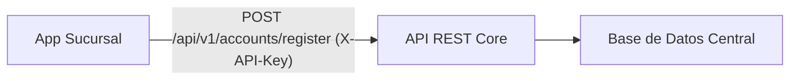

# Sistema Bancario Distribuido - Sucursal (Nodo 2)

Este repositorio contiene la aplicación de la sucursal bancaria. Permite registrar nuevas cuentas de clientes e interactuar con la Base de Datos Central a través del Banco Central (Core) utilizando API Keys.

## 🏛 Arquitectura

El Nodo Sucursal es una aplicación web desarrollada con **Node.js** y **Express**. Se comunica exclusivamente con el Nodo Core (Banco Central) para ejecutar transacciones financieras, garantizando que el saldo global se mantenga consistente.



## ✨ Funcionalidades

- **Registro de Cuentas:** Apertura de cuentas bancarias para nuevos clientes con un saldo inicial.
- **Seguridad:** Autenticación de las peticiones hacia el Core utilizando `X-API-Key`.
- **Panel Administrativo:** Interfaz básica para la gestión de la sucursal (dependiendo de la implementación local).

## 🚀 Despliegue

La aplicación de la sucursal está desplegada en [Enlace de despliegue en Coolify/Vercel].

## ⚙️ Configuración e Instalación Local

1. **Clonar el repositorio:**
   ```bash
   git clone https://github.com/TopWebTec/sucursal-admin.git
   cd sucursal-admin
   ```

2. **Instalar dependencias:**
   ```bash
   npm install
   ```

3. **Configurar el archivo `.env`:**
   Crea un archivo `.env` en la raíz del proyecto y configura las siguientes variables:
   ```env
   # URL del Banco Central (Core)
   CENTRAL_API_URL=http://localhost:8000/api
   
   # API Key generada desde el Panel de Administración del Core
   SUCURSAL_API_KEY=tu_api_key_aqui
   
   # ID del nodo de la sucursal registrado en el Core
   SUCURSAL_NODE_ID=id_del_nodo_aqui
   
   # Puerto local
   PORT=3000
   ```

4. **Iniciar el servidor de desarrollo:**
   ```bash
   npm run dev
   ```
   *Nota: Es necesario tener iniciado el servidor del Banco Central (Core) para poder registrar cuentas exitosamente.*
